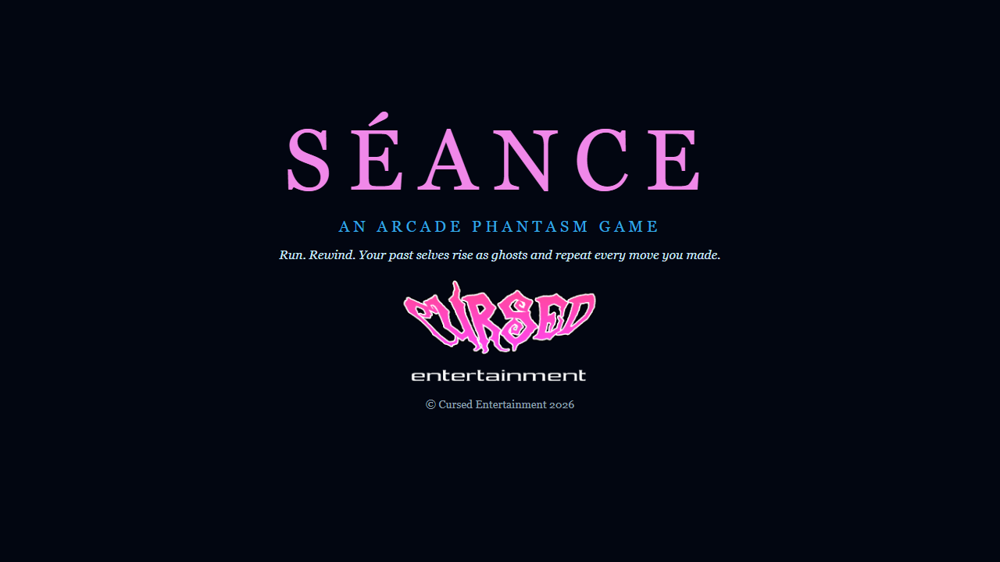
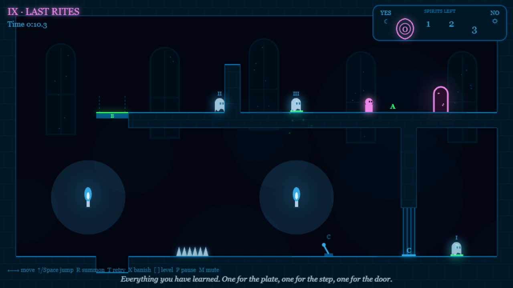
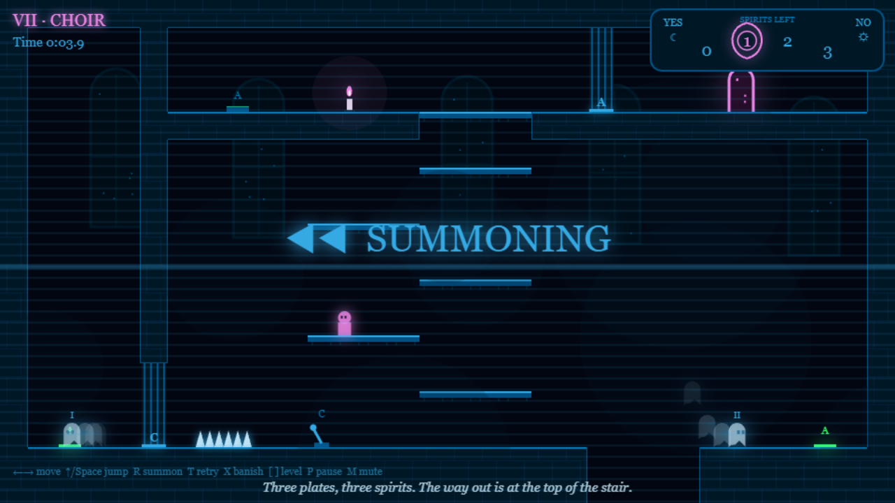

 

  

 

  
  
  

 

# SÉANCE

**An [Arcade Phantasm](https://arcade-phantasm.netlify.app/) game** · **[Play it](https://cursedprograms.github.io/Seance/)**

A side-view platformer where you summon your own past. Run a dangerous room, then rewind: time runs back to the start of the attempt and the run you just made rises as a pale blue ghost that repeats it frame by frame. Your ghosts hold pressure plates, ride lifts and lend you their heads to stand on, so the living you (solid pink) can get through.

**The twist:** you only get a few spirits per room, counted on the Ouija board in the corner. Every room needs exactly that many of you working together.

  
  
   
  

## Versions

- **Browser**: this one, right here at the repo root. [Play it](https://cursedprograms.github.io/Seance/).
- **Windows exe**: in `cpp/`: download `Seance-win64.zip` from the [latest release](https://github.com/CursedPrograms/Seance/releases/latest), unzip, run `Seance.exe`. See [Windows exe](#windows-exe) below.
- **Android**: in `android/`, the APK in [`android/apk/`](android/apk/). See [Android](#android) below.

## How to play

Reach the glowing pink arch. Doors open while every plate (or lever) with their letter is held; lifts rise while their plate is held; a lever keeps its gate open for a moment after you leave it. Spikes and pits kill the living, never the dead.

Make a run that does one job (stand on a plate, ride the lift, wait by a wall), then press **R**. The candles burn blue, time rewinds, and that run becomes a ghost. Ghosts can stand on each other, and you can stand on them. A ghost fades when its run ends, so let it wait long enough.

Nine rooms, from one spirit to three:

| | Room | Spirits | What's new |
|---|---|---|---|
| I | First Light | 1 | a plate holds a door open |
| II | Ascension | 1 | a lift that rises while its plate is held |
| III | Stand on Me | 1 | the living can stand on the dead |
| IV | Two Candles | 2 | a door with two plates; a lever and a timed gate |
| V | The Bell Tower | 2 | ghosts ride lifts too |
| VI | Ladder of Souls | 2 | stacking ghosts |
| VII | Choir | 3 | three plates in three corners |
| VIII | Stair of Souls | 3 | a three-ghost stair |
| IX | Last Rites | 3 | everything at once |

Your best time for each room is saved in the browser, and the game picks up at the first room you haven't solved.

## Controls

| Key | |
|---|---|
| ← → / A D | move |
| ↑ / W / Space / Z | jump (hold for higher) |
| R | rewind and summon this run as a ghost |
| T | rewind and try again, no ghost |
| X | banish all ghosts and restart the room |
| [ ] | previous / next room (solved ones) |
| P | pause |
| M | mute |

On a phone: the arrow and jump buttons at the bottom, plus R (summon), T (try again) and P (pause).

The physics runs at a fixed 60 steps a second, so every ghost repeats its run exactly.

## Windows exe

C++17 with SDL2, OpenGL 3, [Dear ImGui](https://github.com/ocornut/imgui) and [stb](https://github.com/nothings/stb).
The same game as the browser one: the same nine rooms, the same fixed 60-step physics (so ghosts replay exactly), the
Ouija board, the candles, the sound effects (made as it plays, no audio files) and the Georgia lettering. Arrows / A D
move, Up / W / Space / Z jump, R summon, T retry, X banish, [ ] or PgUp / PgDn room, P pause, M mute, F11 fullscreen,
Esc menu. Solved rooms and best times are kept in your user settings folder.

To build it: Visual Studio 2022 (C++) and CMake, then `cpp/build.bat` (or `build.ps1`; `build.sh` on Linux with
SDL2 installed). It fetches SDL2 once into `cpp/external/`, builds `cpp/build/Release/Seance.exe` and packs
`cpp/dist/Seance-win64.zip`. The code: `cpp/src/main.cpp` (window, splash), `game.cpp` (rooms, physics, drawing),
`canvas.cpp` (a small canvas-like drawing layer over ImGui), `synth.cpp` (the sound effects).

## Android

The browser game in an Android app: it plays offline, full screen in landscape, with the sound on from the start
(Android 7.0 or newer).

- **Download**: the APK in [`android/apk/`](android/apk/). Copy it to the phone and open it (allow installs from
  unknown sources when asked).
- **Build it**: the Android SDK and JDK 17, then `android/build.bat` (or `build.ps1`, `build.sh`). It runs
  `gradlew assembleDebug` and leaves the APK in `android/apk/`. The game's web files are copied into the app at build
  time, so the browser game at the repo root stays the only copy.
- **The code**: `android/app/src/main/java/com/synthwomb/seance/MainActivity.kt`, a full-screen WebView that serves the
  game from the app's assets. Press Back twice to leave.

## Files

- `index.html`: the page: the canvas, the splash, the touch buttons
- `site/style.css`: the page styling
- `site/game.js`: the game: rooms, fixed-step physics, ghosts, drawing, input
- `site/sfx.js`: the sound effects, made with Web Audio (no audio files)
- `images/`: the Cursed logo and the screenshots

## Also in the arcade

[KillerStardust](https://github.com/CursedPrograms/KillerStardust) · [ProtocolHex](https://github.com/CursedPrograms/ProtocolHex) · [Seance](https://github.com/CursedPrograms/Seance) · RicochetReaper · GraveDanger · Vortex · Orbit · RocksOfRuin · Devourer

 

© Cursed Entertainment 2026

 

